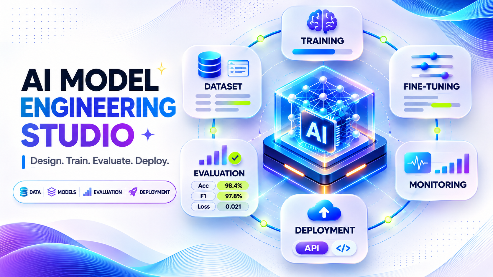
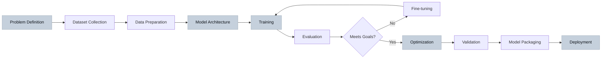

<div align="center">



[](https://claude.ai/code) [](https://www.opencode.dev/) [](#master-skill-architecture) [](#internal-specialist-modules) [](#)

**Coordinated AI model engineering workflows from dataset preparation to production deployment**

[Quick Start](#quick-start) • [Architecture](#master-skill-architecture) • [Workflow](#ai-model-engineering-workflow) • [Installation](#claude-code-installation) • [Documentation](#documentation-and-resources)

</div>

---

## About AI Model Engineering Studio

AI Model Engineering Studio provides a coordinated master skill for end-to-end machine learning and deep learning model development. From initial dataset preparation through training, evaluation, optimization, and deployment, this repository orchestrates specialized engineering capabilities through one discoverable entry point.

Unlike application development with pre-trained models, this studio focuses on **building, training, and deploying custom models** with reproducible experiments, data governance, rigorous evaluation, and realistic compute constraints.

**Key characteristics:**
- **One master skill** coordinates all specialist modules automatically
- **Five internal specialist modules** for different model engineering domains
- **Reproducible workflows** with experiment tracking and versioning
- **Production-ready guidance** for optimization, serving, and monitoring
- **Responsible AI** considerations throughout the development cycle

---

## Project Overview and Statistics

| Metric | Value | Description |
|--------|-------|-------------|
| **Discoverable Skills** | 1 | `ai-model-engineering-studio` master skill |
| **Internal Modules** | 5 | Specialist reference playbooks |
| **Supported Frameworks** | 10+ | PyTorch, TensorFlow, JAX, scikit-learn, and more |
| **Model Types** | 5+ | Neural networks, LLMs, computer vision, ML, custom architectures |
| **Deployment Targets** | Multiple | Local, cloud, edge, containerized, serverless |

### Repository Statistics

```
Total Lines:        ~15,000+
Skill Files:        1 master + 5 modules
Templates:          Configuration, training, evaluation
Scripts:            Validation, setup, utilities
Documentation:      Comprehensive guides and references
```

---

## What Can You Build?

AI Model Engineering Studio supports development across multiple model engineering domains:

- **Custom neural network architectures** for specific tasks and constraints
- **Fine-tuned language models** adapted to domain-specific data and use cases
- **Computer vision models** for classification, detection, segmentation, tracking
- **Machine learning pipelines** with feature engineering and model selection
- **Multimodal models** combining vision, language, and structured data
- **Efficient model variants** optimized for edge devices and resource constraints
- **Production model serving** with monitoring, versioning, and A/B testing
- **Experiment tracking systems** for reproducible model development

---

## Master Skill Architecture

This repository exposes **one discoverable skill** that coordinates the complete model engineering workflow:

```
ai-model-engineering-studio
```

The master skill automatically loads relevant internal specialist modules based on your project requirements. You select only the master skill—individual modules are internal references, not separate skills to invoke.

### Invocation

**Claude Code:**
```
/ai-model-engineering-studio
```

**OpenCode:**
```
@ai-model-engineering-studio
```

The master skill inspects your project, identifies requirements, loads appropriate specialist playbooks, and coordinates the end-to-end workflow from a single entry point.

---

## Internal Specialist Modules

The master skill coordinates these five internal specialist reference modules:

| Module | Purpose | Loaded When |
|--------|---------|-------------|
| **llm-engineer** | Large language model engineering, training, fine-tuning | LLM development, transformer architectures, text generation |
| **neural-network-engineer** | Neural network architecture design and implementation | Custom architectures, layer design, network optimization |
| **machine-learning-engineer** | Classical ML, feature engineering, model selection | Tabular data, ensemble methods, statistical models |
| **model-training-engineer** | Training loops, optimization, experiment tracking | Training configuration, hyperparameter tuning, reproducibility |
| **computer-vision-engineer** | Vision models, image/video processing, detection | Image classification, object detection, segmentation |

**Important:** These modules are internal references within the master skill's `references/` directory. Users invoke only `ai-model-engineering-studio`—the master skill loads relevant modules automatically based on project needs.

---

## AI Model Engineering Workflow



**Note:** Actual workflow varies by model type, project requirements, and compute constraints. Some stages may iterate multiple times or run in parallel.

---

## Machine Learning Development

Classical machine learning engineering for structured data, tabular datasets, and statistical modeling:

- **Feature engineering** and selection for optimal model performance
- **Model selection** across algorithms (linear, tree-based, ensemble, kernel methods)
- **Cross-validation** strategies and performance estimation
- **Hyperparameter optimization** with grid search, random search, Bayesian methods
- **Ensemble methods** combining multiple models for improved accuracy
- **Model interpretation** and feature importance analysis
- **Pipeline construction** for reproducible preprocessing and training

**Typical use cases:** Regression, classification, clustering, anomaly detection, time series forecasting, recommendation systems with structured features.

---

## Neural Network Engineering

Custom neural network architecture design and deep learning model development:

- **Architecture design** for feedforward, convolutional, recurrent, transformer networks
- **Layer selection** and configuration for specific tasks and data types
- **Activation functions** and initialization strategies
- **Regularization techniques** (dropout, batch normalization, weight decay)
- **Loss function design** for custom objectives
- **Gradient flow optimization** and residual connections
- **Model capacity** balancing between underfitting and overfitting
- **Transfer learning** leveraging pre-trained components

**Frameworks supported:** PyTorch, TensorFlow/Keras, JAX, ONNX for interoperability.

---

## Large Language Model Engineering

Language model development, fine-tuning, and adaptation:

- **Model architecture** selection (decoder-only, encoder-decoder, encoder-only)
- **Tokenization** strategy and vocabulary design
- **Pre-training** from scratch on domain-specific corpora (compute-intensive)
- **Fine-tuning** pre-trained models for specific tasks and domains
- **Parameter-efficient fine-tuning** (LoRA, adapters, prefix tuning)
- **Instruction tuning** and alignment techniques
- **Context length** optimization and efficient attention mechanisms
- **Inference optimization** for text generation and latency reduction
- **Prompt engineering** and few-shot learning strategies

**Important:** Training large language models from scratch requires substantial compute resources (multi-GPU clusters, weeks of training time). Fine-tuning existing models is more accessible for most projects.

---

## Dataset Preparation and Management

Data quality, governance, and preprocessing for reliable model training:

- **Dataset collection** and provenance tracking
- **Data quality** validation and cleaning
- **Labeling strategies** and annotation workflows
- **Train/validation/test splits** with stratification and temporal considerations
- **Data augmentation** techniques for improved generalization
- **Feature preprocessing** (normalization, encoding, transformation)
- **Privacy protection** and sensitive data handling
- **Data versioning** for reproducible experiments
- **Bias detection** and mitigation in training data

**Critical considerations:** Dataset licensing, attribution requirements, personally identifiable information (PII), data leakage prevention between splits.

---

## Model Training and Experimentation

Reproducible training workflows with experiment tracking and resource management:

- **Training loop** implementation with gradient accumulation and mixed precision
- **Optimization algorithms** (SGD, Adam, AdamW, custom optimizers)
- **Learning rate scheduling** and warmup strategies
- **Batch size** selection and gradient accumulation for memory constraints
- **Checkpointing** and model saving strategies
- **Early stopping** and convergence monitoring
- **Distributed training** across multiple GPUs and nodes
- **Experiment tracking** with metrics, hyperparameters, and artifacts
- **Reproducibility** via fixed seeds, deterministic operations, environment versioning

**Tools:** Weights & Biases, MLflow, TensorBoard, Neptune, custom logging solutions.

---

## Fine-tuning and Adaptation

Adapting pre-trained models to new domains, tasks, and data distributions:

- **Transfer learning** strategies and layer freezing
- **Domain adaptation** for distribution shift
- **Task-specific fine-tuning** with appropriate loss functions
- **Few-shot learning** and meta-learning approaches
- **Parameter-efficient methods** reducing memory and compute requirements
- **Continual learning** avoiding catastrophic forgetting
- **Data efficiency** techniques for limited labeled data
- **Curriculum learning** and progressive training strategies

**Balance:** Pre-trained model capabilities vs. task-specific requirements, computational budget, available training data.

---

## Computer Vision Engineering

Image and video model development for visual understanding tasks:

- **Image classification** architectures (ResNet, EfficientNet, Vision Transformers)
- **Object detection** models (YOLO, Faster R-CNN, DETR)
- **Semantic segmentation** for pixel-level understanding
- **Instance segmentation** separating individual objects
- **Video understanding** and temporal modeling
- **Pose estimation** and keypoint detection
- **Image generation** and synthesis models
- **Self-supervised learning** from unlabeled visual data
- **Model compression** for real-time inference on edge devices

**Datasets:** ImageNet, COCO, Open Images, domain-specific collections. Ensure proper licensing and attribution.

---

## Model Evaluation and Benchmarking

Rigorous evaluation beyond training metrics for production readiness:

- **Performance metrics** appropriate for task type and domain
- **Cross-validation** and holdout test set evaluation
- **Confusion matrices** and error analysis
- **Robustness testing** on out-of-distribution data
- **Adversarial evaluation** and failure case identification
- **Calibration** ensuring predicted probabilities match true frequencies
- **Fairness metrics** across demographic groups and sensitive attributes
- **Latency and throughput** profiling
- **Memory footprint** and resource utilization
- **Benchmark comparisons** against baselines and state-of-the-art

**Critical:** Do not claim production readiness based on training metrics alone. Test on realistic data, edge cases, and deployment conditions.

---

## Model Optimization and Inference

Performance optimization for production deployment constraints:

- **Quantization** reducing precision for faster inference (INT8, INT4, mixed)
- **Pruning** removing unnecessary parameters and connections
- **Knowledge distillation** training smaller models from larger teachers
- **Model compilation** optimizing computation graphs
- **Batching strategies** for throughput optimization
- **Caching** and memoization for repeated inputs
- **Hardware acceleration** leveraging GPUs, TPUs, specialized accelerators
- **ONNX export** for cross-framework deployment
- **TensorRT, OpenVINO** optimization for specific hardware
- **Mobile deployment** (CoreML, TensorFlow Lite, ONNX Runtime Mobile)

**Important:** Optimize against measured bottlenecks, not assumptions. Profile before optimizing.

---

## Quick Start

### Prerequisites

- Compatible AI coding agent (Claude Code or OpenCode)
- Python 3.8+ for model development workflows
- Git for version control and collaboration

### Project-Level Installation

1. **Copy skill to target project:**
   ```bash
   cp -r .claude/skills/ai-model-engineering-studio /path/to/your/project/.claude/skills/
   ```

2. **Verify skill is discoverable:**
   - Check agent's available skills list
   - Skill should appear as `ai-model-engineering-studio`

3. **Invoke master skill:**
   - Claude Code: `/ai-model-engineering-studio`
   - OpenCode: `@ai-model-engineering-studio`

4. **Provide project requirements:**
   - Model type and objective
   - Dataset information and location
   - Compute constraints and hardware
   - Target deployment environment

---

## Claude Code Installation

For Claude Code desktop app, CLI, or VS Code extension:

1. **Clone repository:**
   ```bash
   git clone https://github.com/TheMamunZx/ai-model-engineering-studio.git
   cd ai-model-engineering-studio
   ```

2. **Copy to target project:**
   ```bash
   cp -r .claude/skills/ai-model-engineering-studio /path/to/your/ml/project/.claude/skills/
   ```

3. **Invoke from project:**
   ```
   /ai-model-engineering-studio
   ```

4. **Verify skill loaded:**
   - Master skill should coordinate internal modules automatically
   - Confirm skill appears in available skills list

**Note:** Skill discovery behavior varies by Claude Code version and configuration. Consult Claude Code documentation for environment-specific setup.

---

## OpenCode Installation

For OpenCode agent integration:

1. **Clone repository:**
   ```bash
   git clone https://github.com/TheMamunZx/ai-model-engineering-studio.git
   ```

2. **Add to project skills:**
   ```bash
   cp -r .claude/skills/ai-model-engineering-studio /path/to/your/project/.claude/skills/
   ```

3. **Invoke with @ syntax:**
   ```
   @ai-model-engineering-studio
   ```

4. **Provide model engineering context:**
   - Describe model type, data, and objectives
   - Specify constraints and requirements
   - Master skill loads appropriate modules

Refer to OpenCode documentation for agent-specific skill configuration and discovery patterns.

---

## Supported Frameworks and Technologies

**Note:** This repository provides workflow coordination and engineering guidance. Actual framework availability depends on your environment's installed dependencies, not this repository's contents.

### Machine Learning Frameworks

| Framework | Use Cases | Notes |
|-----------|-----------|-------|
| **PyTorch** | Neural networks, deep learning, research | Most flexible, strong ecosystem |
| **TensorFlow/Keras** | Production deployment, mobile/edge | Comprehensive deployment tools |
| **JAX** | High-performance computing, research | Functional approach, XLA compilation |
| **scikit-learn** | Classical ML, preprocessing, pipelines | Extensive algorithm library |
| **XGBoost** | Gradient boosting, structured data | High performance on tabular data |
| **LightGBM** | Fast gradient boosting | Memory efficient, distributed |
| **Hugging Face Transformers** | Pre-trained language and vision models | Largest model hub |

### Experiment Tracking and MLOps

- **Weights & Biases** — comprehensive experiment tracking and collaboration
- **MLflow** — open-source ML lifecycle management
- **TensorBoard** — visualization and monitoring
- **Neptune** — team experiment tracking
- **DVC** — data version control
- **ClearML** — experiment management and orchestration

### Model Serving and Deployment

- **TorchServe** — PyTorch model serving
- **TensorFlow Serving** — TensorFlow model serving
- **ONNX Runtime** — cross-framework inference
- **FastAPI** — custom REST API endpoints
- **Triton Inference Server** — multi-framework serving
- **BentoML** — model packaging and deployment
- **Seldon Core** — Kubernetes-native model serving

### Optimization and Acceleration

- **ONNX** — model interoperability format
- **TensorRT** — NVIDIA GPU optimization
- **OpenVINO** — Intel hardware optimization
- **PyTorch JIT** — compilation and optimization
- **TFLite** — mobile and edge deployment
- **CoreML** — Apple device deployment

**Important:** Verify framework availability and versions in your environment. This list documents common workflows, not installed dependencies.

---

## Hardware and Compute Requirements

### Development Environment

**Minimum (CPU-only):**
- Modern multi-core CPU (8+ threads recommended)
- 16 GB RAM (32 GB+ for larger models)
- 100+ GB storage for datasets and checkpoints
- Suitable for: small models, prototyping, classical ML, fine-tuning with small parameter counts

**Recommended (GPU-accelerated):**
- NVIDIA GPU with 8+ GB VRAM (RTX 3060/3070, RTX 4060 Ti, A4000+)
- 32+ GB system RAM
- 500+ GB SSD storage
- CUDA toolkit and compatible drivers
- Suitable for: neural network training, computer vision, moderate-scale fine-tuning

**Advanced (Multi-GPU):**
- Multiple high-end GPUs (A100, H100, RTX 4090)
- 64+ GB system RAM
- 1+ TB NVMe storage
- Distributed training frameworks
- Suitable for: large model training, LLM fine-tuning, extensive experimentation

### Training Time Expectations

**Small models (< 10M parameters):**
- CPU: Minutes to hours
- Single GPU: Seconds to minutes
- Example: Small CNNs, BERT fine-tuning on small datasets

**Medium models (10M-1B parameters):**
- Single GPU: Hours to days
- Multi-GPU: Hours
- Example: ResNet variants, GPT-2 fine-tuning, ViT models

**Large models (1B+ parameters):**
- Multi-GPU cluster: Days to weeks
- Substantial cloud compute costs
- Example: Training LLMs from scratch, large vision models

### Cloud Training Options

When local hardware is insufficient:

- **AWS EC2** (p3, p4, g5 instances) — flexible, pay-per-hour
- **Google Cloud Platform** (A100, TPU) — TPU access, competitive pricing
- **Azure Machine Learning** — integrated ML platform
- **Lambda Labs** — cost-effective GPU rentals
- **Paperspace Gradient** — notebooks and training workflows
- **RunPod** — affordable spot instances

**Cost consideration:** Large model training can cost hundreds to thousands of dollars in compute. Start with small-scale experiments and scale up after validating approach.

---

## Dataset and Model Configuration

### Dataset Requirements

**Structure:**
```
data/
├── raw/                    # Original unprocessed data
├── processed/              # Cleaned and preprocessed data
├── train/                  # Training split
├── val/                    # Validation split
├── test/                   # Test split (never touch until final evaluation)
└── metadata.json           # Dataset provenance, licensing, statistics
```

**Configuration file (example):**
```yaml
dataset:
  name: "my-dataset"
  task: "classification"
  num_classes: 10
  splits:
    train: 0.7
    val: 0.15
    test: 0.15
  preprocessing:
    - normalize: {mean: [0.485, 0.456, 0.406], std: [0.229, 0.224, 0.225]}
    - resize: {height: 224, width: 224}
  augmentation:
    - random_flip: {p: 0.5}
    - random_crop: {size: 224}
```

### Model Configuration

**Example training config:**
```yaml
model:
  architecture: "resnet50"
  pretrained: true
  num_classes: 10
  
training:
  batch_size: 32
  epochs: 100
  optimizer: "adam"
  learning_rate: 0.001
  scheduler: "cosine"
  mixed_precision: true
  
validation:
  frequency: 1  # epochs
  metrics: ["accuracy", "f1", "precision", "recall"]
  
checkpointing:
  save_best: true
  save_frequency: 10  # epochs
  metric: "val_accuracy"
  
experiment:
  name: "resnet50-baseline"
  tags: ["baseline", "resnet", "pretrained"]
  notes: "Initial baseline with ImageNet pretrained weights"
```

---

## Testing and Validation

### Validation Strategy

**During development:**
```bash
# Run unit tests for data pipeline
python -m pytest tests/test_data.py

# Validate model architecture
python scripts/validate_model.py --config configs/model.yaml

# Check training loop
python scripts/test_training.py --dry-run --steps 10
```

**Before training:**
- Verify dataset splits have no leakage
- Check data augmentation produces valid samples
- Confirm model forward pass on sample batch
- Validate loss computation and gradient flow
- Test checkpointing and resumption

**After training:**
- Evaluate on held-out test set (once only)
- Analyze confusion matrix and failure cases
- Test on out-of-distribution samples
- Profile inference latency and memory
- Verify model serialization and loading

### Repository Validation

Validate skill configuration and structure:

```bash
python scripts/validate_pack.py
```

Checks:
- Master skill file exists and has correct frontmatter
- All referenced internal modules exist
- Basic link integrity
- No accidentally committed secrets

**Note:** Does not verify framework availability, API credentials, or production deployment readiness.

---

## Security, Privacy and Responsible AI

### Data Security

**Protect sensitive data:**
- Never commit datasets containing PII, protected health information, or confidential data
- Use `.gitignore` to exclude data directories
- Encrypt datasets at rest if containing sensitive information
- Document data retention and deletion policies

**Credentials and secrets:**
- Never commit API keys, access tokens, passwords, or private credentials
- Use environment variables or secret management systems
- Rotate keys immediately if accidentally exposed
- Review `.gitignore` before committing

### Privacy Considerations

**Training data:**
- Verify licensing and rights for all training data
- Obtain consent for personal data usage
- Implement differential privacy if required
- Document data sources and provenance

**Model behavior:**
- Test for memorization of training data
- Evaluate privacy leakage risks
- Consider federated learning for sensitive applications

### Responsible AI

**Evaluation requirements:**
- Test on diverse demographic groups
- Measure fairness metrics across sensitive attributes
- Identify and document failure modes
- Assess model robustness and reliability
- Calibrate confidence scores

**Deployment considerations:**
- Document model limitations and failure cases
- Provide uncertainty estimates where appropriate
- Implement monitoring for distribution shift
- Plan for human oversight and intervention
- Create fallback mechanisms for edge cases

**Transparency:**
- Maintain model cards documenting architecture, training data, evaluation, limitations
- Record experiment parameters for reproducibility
- Version models and track lineage
- Communicate capabilities and constraints to stakeholders

**Important:** Do not claim a model is unbiased, safe, or production-ready without thorough evaluation across relevant dimensions and deployment contexts.

---

## Deployment and Model Serving

### Deployment Preparation

**Pre-deployment checklist:**
- [ ] Model evaluated on representative test data
- [ ] Failure cases and limitations documented
- [ ] Inference latency profiled and acceptable
- [ ] Memory footprint measured and within constraints
- [ ] Model serialized and successfully loaded
- [ ] Input validation implemented
- [ ] Error handling for edge cases
- [ ] Monitoring and logging configured
- [ ] Rollback plan prepared

### Serving Patterns

**REST API serving:**
```python
# Example with FastAPI
from fastapi import FastAPI
import torch

app = FastAPI()
model = torch.load("model.pt")
model.eval()

@app.post("/predict")
async def predict(input_data: InputSchema):
    with torch.no_grad():
        output = model(preprocess(input_data))
    return {"prediction": postprocess(output)}
```

**Batch inference:**
- Process large datasets offline
- Optimize for throughput over latency
- Use larger batch sizes
- Consider distributed processing

**Real-time inference:**
- Optimize for latency
- Use model optimization techniques (quantization, pruning)
- Implement caching for repeated inputs
- Consider edge deployment for lowest latency

**Edge deployment:**
- Export to mobile-friendly formats (TFLite, CoreML, ONNX)
- Aggressive model compression
- Test on target hardware
- Implement fallback to cloud when needed

### Monitoring and Maintenance

**Production monitoring:**
- Track inference latency and throughput
- Monitor prediction distribution for drift
- Log confidence scores and uncertainty
- Alert on anomalous inputs or outputs
- Track model version and hardware metrics

**Model updating:**
- Version all model artifacts
- A/B test new models before full deployment
- Maintain rollback capability
- Retrain on new data periodically
- Monitor for dataset shift and concept drift

---

## Output Structure and Deliverables

When model engineering workflow completes, expect these artifacts:

### Training Artifacts

```
outputs/
├── models/
│   ├── checkpoint_epoch_10.pt
│   ├── checkpoint_epoch_20.pt
│   ├── best_model.pt
│   └── final_model.pt
├── logs/
│   ├── training.log
│   ├── tensorboard/
│   └── metrics.csv
├── configs/
│   ├── data_config.yaml
│   ├── model_config.yaml
│   └── training_config.yaml
└── results/
    ├── train_metrics.json
    ├── val_metrics.json
    └── test_metrics.json
```

### Evaluation Reports

- **Performance metrics:** accuracy, precision, recall, F1, AUC, etc.
- **Confusion matrix** and per-class performance
- **Failure case analysis** with examples
- **Robustness evaluation** on challenging subsets
- **Calibration plots** and confidence analysis
- **Latency profiling** and resource usage
- **Comparison to baselines** and prior work

### Model Documentation

**Model card** (minimum requirements):
- Model architecture and size
- Training data description and provenance
- Training procedure and hyperparameters
- Evaluation results on test set
- Known limitations and failure modes
- Intended use cases and out-of-scope applications
- Fairness and bias evaluation results
- Hardware and software requirements
- License and usage restrictions

### Reproducibility Package

```
reproducibility/
├── environment.yaml          # Exact dependencies
├── requirements.txt          # Python packages with versions
├── training_script.py        # Complete training code
├── evaluation_script.py      # Evaluation code
├── seed_config.yaml          # Random seeds for reproducibility
└── hardware_specs.txt        # Training hardware details
```

### Deployment Package

- Optimized model artifacts (quantized, pruned, compiled)
- Input/output schemas and validation
- Preprocessing and postprocessing code
- Inference script or serving configuration
- API documentation
- Deployment instructions
- Monitoring and logging configuration

---

## Troubleshooting and FAQ

### Common Issues

**Q: Out of memory during training**
- Reduce batch size
- Enable gradient accumulation
- Use mixed precision training (fp16/bf16)
- Reduce model size or use gradient checkpointing
- Upgrade hardware or use cloud resources

**Q: Model not converging**
- Check data preprocessing and augmentation
- Verify loss function appropriate for task
- Try different learning rate (often too high)
- Ensure data properly shuffled
- Check for gradient clipping or explosion
- Verify labels are correct

**Q: Good training accuracy but poor validation accuracy**
- Overfitting: add regularization (dropout, weight decay)
- Verify no data leakage between splits
- Increase training data or augmentation
- Simplify model architecture
- Check if validation set represents deployment distribution

**Q: Fine-tuning pre-trained model performs worse than random initialization**
- Learning rate likely too high for fine-tuning
- Try lower learning rate (1e-5 to 1e-4)
- Use learning rate warmup
- Freeze early layers initially
- Verify input preprocessing matches pre-training

**Q: Inference too slow for production requirements**
- Profile to identify bottlenecks
- Apply quantization (INT8, INT4)
- Use model compilation (TorchScript, ONNX, TensorRT)
- Batch multiple requests
- Cache repeated computations
- Consider model distillation to smaller architecture

**Q: Dataset licensing unclear**
- Do not use dataset until licensing confirmed
- Check dataset documentation and terms
- Verify commercial use allowed if applicable
- Attribute sources as required
- Consider alternative datasets with clear licenses

### Debugging Strategies

**Data pipeline:**
```python
# Visualize samples from dataloader
for batch in train_loader:
    visualize_batch(batch)
    break  # Check first batch
```

**Model architecture:**
```python
# Print model summary
from torchinfo import summary
summary(model, input_size=(batch_size, channels, height, width))
```

**Training loop:**
```python
# Enable anomaly detection
torch.autograd.set_detect_anomaly(True)

# Add gradient monitoring
for name, param in model.named_parameters():
    if param.grad is not None:
        print(f"{name}: {param.grad.norm()}")
```

**Inference:**
```python
# Profile inference time
import time
for _ in range(100):  # Warmup
    model(sample_input)

start = time.time()
for _ in range(1000):
    model(sample_input)
latency = (time.time() - start) / 1000
print(f"Average latency: {latency*1000:.2f} ms")
```

---

## Documentation and Resources

### Internal Documentation

- [Master Skill](.claude/skills/ai-model-engineering-studio/SKILL.md) — Entry point and workflow coordination
- [Agent Operating Guide](AGENTS.md) — Rules for agent behavior
- [Skill Manifest](skill-manifest.json) — Repository structure and module metadata
- [Internal Modules](.claude/skills/ai-model-engineering-studio/references/) — Specialist reference playbooks

### Framework Documentation

**Deep Learning:**
- [PyTorch Documentation](https://pytorch.org/docs/)
- [TensorFlow Documentation](https://www.tensorflow.org/api_docs)
- [JAX Documentation](https://jax.readthedocs.io/)
- [Hugging Face Documentation](https://huggingface.co/docs)

**Machine Learning:**
- [scikit-learn Documentation](https://scikit-learn.org/stable/documentation.html)
- [XGBoost Documentation](https://xgboost.readthedocs.io/)
- [LightGBM Documentation](https://lightgbm.readthedocs.io/)

**MLOps and Tracking:**
- [Weights & Biases Documentation](https://docs.wandb.ai/)
- [MLflow Documentation](https://mlflow.org/docs/latest/index.html)
- [DVC Documentation](https://dvc.org/doc)

### Learning Resources

**Model Development:**
- [Deep Learning Book](https://www.deeplearningbook.org/) — Ian Goodfellow et al.
- [Dive into Deep Learning](https://d2l.ai/) — Interactive deep learning textbook
- [Papers with Code](https://paperswithcode.com/) — Research papers and implementations

**Responsible AI:**
- [Model Cards for Model Reporting](https://arxiv.org/abs/1810.03993) — Mitchell et al.
- [Datasheets for Datasets](https://arxiv.org/abs/1803.09010) — Gebru et al.
- [Fairness and Machine Learning](https://fairmlbook.org/) — Barocas, Hardt, Narayanan

**Production ML:**
- [Rules of Machine Learning](https://developers.google.com/machine-learning/guides/rules-of-ml) — Google
- [Hidden Technical Debt in ML Systems](https://papers.nips.cc/paper/2015/file/86df7dcfd896fcaf2674f757a2463eba-Paper.pdf) — Sculley et al.

### Community and Support

- **GitHub Issues:** Report bugs and request features
- **Discussions:** Share workflows and ask questions
- **Contributing:** See contribution guidelines before submitting PRs

---

<div align="center">

**AI Model Engineering Studio**

Build, train, and deploy production-ready AI models with reproducible workflows

[⬆ Back to Top](#)

</div>
